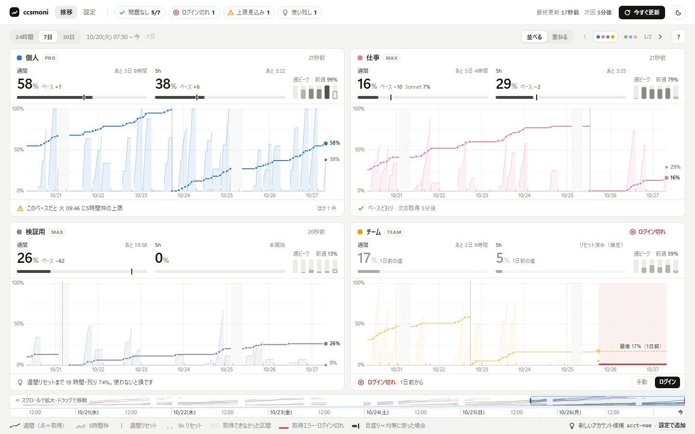

# ccsmoni（ししすもに）

複数の Claude Code アカウントの**利用状況（5時間枠・週間枠）を定期的に記録し、推移をダッシュボードで見られるようにする**、Windows 向けの個人用ツールです。



> **非公式のツールです。** Anthropic とは関係がなく、Anthropic の承認や保証を受けたものではありません。「Claude」「Claude Code」は Anthropic の商標です。

## できること

- **アカウントごとのタイル**に、次のものを並べます（グラフの軸は全タイルで共通です）
  - 今の使用率とリセットまでの時間
  - 均等に使った場合のペースの目盛り
  - 週ごとのピーク
  - 推移のミニグラフ
- **重ねる表示**では、全アカウントの推移を1枚に重ね、その下にアカウントごとの 5h 枠のレーンを出します
- **時間軸を自由に動かせます**
  - グラフの上をドラッグすると、その範囲に拡大します
  - 下の時間軸でスクロールすると拡大・縮小、ドラッグすると移動します
  - Esc で、24時間／7日／30日のプリセットに戻ります
- **ヒント**（「このペースだと 金 14:00 に上限」「使わないと損」）と**状態のバッジ**を出します。バッジにホバーすると、該当するアカウントを強調します
- **ログイン切れ**を検知し、［ログイン］を押すと、PC 上にそのアカウント用のログイン画面が開きます
- 設定は画面から編集できます。中身は TOML ファイルで、直接編集しても反映されます
- [Tailscale](https://tailscale.com/) を使えば、自分の tailnet 内のスマホからも見られます

## しくみ

アカウントは「Claude Code の設定フォルダ」（環境変数 `CLAUDE_CONFIG_DIR`）の単位で扱います。ccsmoni は、アカウントごとに次の2つのコマンドを定期的に実行し、その結果を SQLite に記録します。

```
claude auth status --json                                           # ログイン状態の確認
claude -p /usage --output-format json --no-session-persistence      # 使用率の取得
```

- `/usage` は Claude Code に組み込まれたコマンドです。モデルは呼ばれず、料金もかかりません（1回 2〜4 秒）。
- ccsmoni が実行するのは、改変していない `claude` CLI の機能だけです。**ログイン情報（トークン）は読み取りも保存もしません**。
- 取得した生のテキストも保存します。`/usage` の表示形式が変わったときは、パーサーを直したうえで `ccsmoni reparse` を実行すれば、過去の分も作り直せます。

## 注意事項

- `/usage` の出力は公開された API ではなく、画面表示用のテキストです。Claude Code の更新で形式が変わると、取得できなくなることがあります。
- 利用にあたっては、Anthropic の利用規約（[Legal and compliance](https://code.claude.com/docs/en/legal-and-compliance)）に従ってください。自己責任でお使いください。
- ccsmoni には認証がありません。PC のループバック（127.0.0.1）でだけ待ち受けます。tailnet に公開する場合は、自分専用の tailnet で使うことを前提にしています。

## 必要なもの

- Windows（動作確認は Windows 11）
- [uv](https://docs.astral.sh/uv/)（Python は uv が用意します）
- PATH の通った `claude`（Claude Code CLI）
- （スマホから見る場合）Tailscale

## 使い方

### 起動

`ccsmoni.bat` をダブルクリックします。

- 初回は、依存関係をインストールしてから起動し、ブラウザでダッシュボードを開きます。
- すでに起動しているときは、ブラウザで開くだけです。
- 止めるときは、コンソールウィンドウを閉じます。

コマンドラインから起動するなら `uv run ccsmoni serve` です。

### アカウントの登録

- 初回の起動時に、ホームフォルダ以下（深さ2まで）から Claude Code の設定フォルダ（`.credentials.json` か `.claude.json` があるフォルダ）を探し、見つかったものを登録します。
- 画面の「設定」では、次のことができます。
  - 表示名・色・取得間隔・起動コマンドの変更（起動コマンドは、ログインの案内でコピーするためのもの。例: `claude-work`）
  - 無効化・並べ替え・追加・削除
  - 1ページに並べるタイルの数
- 設定ファイルと DB は `%LOCALAPPDATA%\ccsmoni\` にあります（環境変数 `CCSMONI_HOME` で場所を変えられます）。
- 安全のため、次の項目は画面からは変えられません。設定ファイルで編集してください。
  - `collector.claude_path`（ファイル名が `claude` のものだけ指定できます）
  - `server.host`（ループバックだけ指定できます）
  - `server.port`

### スマホから見る（Tailscale）

```
ccsmoni.bat --setup-tailscale
```

- ccsmoni 専用の HTTPS ポート（既定は 8484）で、tailnet 内に公開します。URL は `https://<PC名>.<tailnet名>.ts.net:8484/` です。実行するのは初回だけです。
- 既定の `https://<PC名>.ts.net/` に別のアプリを公開していても、その設定には触れません。同じポートを別の公開先が使っている場合は、上書きせずに止まります。
- `*.ts.net` 以外のホスト名で開く場合は、設定の `server.allowed_hosts` に追加してください（許可していない Host からのリクエストは拒否します）。

## コマンド

`uv run ccsmoni <コマンド>` の形で実行します。

| コマンド | 内容 |
|---|---|
| `serve [--port N] [--no-browser]` | 常駐して定期的に取得し、ダッシュボードを配信する |
| `collect --once --print [--save]` | 1回だけ取得して、表で表示する（`--save` を付けると DB に保存する） |
| `reparse` | 保存済みの生テキストから、DB の内容を作り直す |
| `parse <file>` | 保存した `/usage` のテキストをパースして、JSON で表示する |
| `tailscale-setup` | Tailscale での公開を設定する |
| `demo --home <dir> [--accounts N]` | 架空のアカウントと30日分の履歴を作る（画面の確認用。`CCSMONI_HOME=<dir>` にしてから `serve --demo` で表示する） |

## 開発

```
uv sync
uv run pytest -q
```

- 構成
  - `src/ccsmoni/` … パーサー（`parser_usage.py`）、取得（`probes/`）、保存（`store.py`）、ペースとヒント（`insights.py`）、スケジューラ、ログイン、設定、Web サーバー（`web.py`）
  - `src/ccsmoni/static/` … ビルド工程のない UI（素の JS と canvas）
- サーバーと UI の API の仕様: [docs/API.md](docs/API.md)
- 設計の経緯（計画、ダッシュボードの設計、レビューの記録）: [docs/design/](docs/design/)
- `.githooks/pre-commit` は、git 管理外の `local/secret-words.txt` に書いた語がコミットに含まれていないかを確かめるフックです（`git config core.hooksPath .githooks` で有効になります）。リストが無ければ何もしません。

## ライセンス

[MIT](LICENSE)
